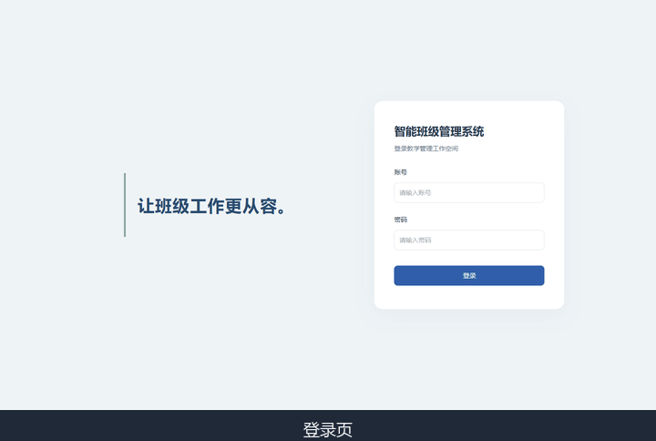

# 智能班级管理系统

班主任可以用这个系统导入学生名单、录入成绩、查看班级统计，也可以在同一个页面管理作业和考勤。Windows 上可先用 H2 便携版试用。



> 演示画面由真实运行的本地实例自动截取（`scripts/Capture-DemoShots.js`），数据全部为虚构名单。

## 它解决什么

例如先导入一个班的学生名单，再录入一次考试的成绩，就能按班查看均分和及格率。AI 助手可查询这些记录或生成修改预览，确认后才会写入。

## 特性

- **一处录入，多处统计**：成绩、考勤、作业、表扬同库；缺考与 0 分严格区分，均分和及格率排除缺考
- **文件导入可控**：CSV / 单工作表 XLSX，先预览后事务写入，不覆盖已有学号
- **AI 只读为主**：查询用工具白名单，没有 SQL 拼接、没有系统命令；写入走「预览 → 确认 → 落库」
- **软删除与回收站**：删除可恢复；有业务引用的学生不允许删除，只能改离校
- **两种运行形态**：开发用 MySQL，分发用免安装的 H2 便携包

## 快速开始

### 方式一：便携版（不装数据库）

在 Windows 上安装 PowerShell 7、JDK 17 与 Node.js 20.19+/22.12+，只需一次构建：

```powershell
pwsh -File scripts/Build-Portable.ps1
```

产物在 `output/portable-<时间戳>/ClassManagement/`，双击其中的 `Start.cmd`。首次启动会让你设置管理员密码（至少 12 位），数据落在同目录的 H2 文件里。浏览器打开 `http://127.0.0.1:18765/`。

### 方式二：开发模式（MySQL + 前后端分离）

在 Windows 上使用 PowerShell 7，并先启动 Docker。

```powershell
# 1. 起数据库（MySQL 8.4，映射到 3310）
docker compose up -d --wait

# 2. 构建后端（仓库自带 Maven Wrapper，无需预装 Maven）
cd backend
.\mvnw.cmd -Pisolated-build "-Dverification.build.directory=target-phase7-agent" package
cd ..

# 3. 配置后端环境变量（PowerShell 示例）
$env:DB_URL='jdbc:mysql://127.0.0.1:3310/class_management_demo?useUnicode=true&characterEncoding=utf8&serverTimezone=Asia/Shanghai'
$env:DB_USERNAME='root'
$env:DB_PASSWORD='demo-root-only'   # 与 docker-compose.yml 中的 MYSQL_ROOT_PASSWORD 一致
$env:BOOTSTRAP_ADMIN_USERNAME='admin'
$env:BOOTSTRAP_ADMIN_PASSWORD='<首次初始化用，至少 12 位>'
# 可选：将自己的 DeepSeek Key 设置到 DEEPSEEK_API_KEY

# 4. 先安装前端依赖
cd frontend
npm ci
cd ..
# 5. 启动后端和前端
pwsh -File scripts/Start-AgentLocal.ps1
```

打开 `http://127.0.0.1:15174/`，用第 3 步设置的管理员账号登录。
启动脚本首次生成 JWT 密钥并保存在本机的 `.secrets/` 目录。若自定义 Compose 的数据库密码，同时更新 `DB_PASSWORD`。

更详细的配置项、常见问题见 [快速开始文档](docs/QUICKSTART.md)。

## 技术栈

| 层 | 选型 |
|---|---|
| 后端 | Java 17、Spring Boot 3.3.5、Spring Security + JWT、Flyway、POI + Commons CSV |
| 数据访问 | JdbcTemplate 原生 SQL（业务侧）+ Spring Data JPA（学生/班级/用户） |
| 前端 | Vue 3、Vite 6、Element Plus、Pinia、Vue Router |
| 数据库 | MySQL 8.4（需 CHECK 约束，8.0.16+）；测试与便携模式用 H2 |
| AI | DeepSeek 官方 HTTP 工具调用；Dify 为可选备选引擎 |
| 测试 | JUnit 5，默认在 H2 上运行 |

## 目录结构

```text
backend/src/main/java/       认证、业务服务、AI 工具与 REST API
backend/src/main/resources/  配置与 Flyway 增量迁移（V1–V5）
backend/src/test/            H2 / MySQL 自动化测试
frontend/src/                Vue 工作台、管理页与 AI 页面
scripts/                     启动、演示数据初始化、便携打包、密钥扫描
docs/                        架构、数据库、AI 设计、UI 规范与开发日志
```

## 配置项

后端全部通过环境变量配置，仓库不含任何本机路径。

| 变量 | 默认值 | 说明 |
|---|---|---|
| `DB_URL` | `jdbc:mysql://localhost:3306/class_management...` | 必须指向 `class_management_demo`（脚本层强制校验） |
| `DB_USERNAME` / `DB_PASSWORD` | `root` / 空 | 数据库账号 |
| `JWT_SECRET` | 无（必填） | 至少 32 字节；变更后旧令牌全部失效 |
| `BOOTSTRAP_ADMIN_USERNAME` | `admin` | 仅在账号不存在时创建 |
| `BOOTSTRAP_ADMIN_PASSWORD` | 空 | 留空则跳过初始化；填了必须 ≥12 位 |
| `SERVER_PORT` | `8092`（脚本内设） | 后端端口 |
| `DEEPSEEK_API_KEY` | 空 | 不填则 AI 助手返回明确的未配置错误 |
| `MYSQL_BIN` | `%ProgramFiles%\MySQL\MySQL Server 8.4\bin` | 本机 MySQL 可执行文件目录 |
| `DEMO_DB_DATADIR` | `<仓库>/.data/mysql` | 演示库数据目录；**不能含非 ASCII 字符** |

`scripts/Start-AgentLocal.ps1` 在 `DB_URL` 上做库名白名单校验，避免误连其他数据库写入演示数据。

## 权限

| 操作 | ADMIN | TEACHER |
|---|---|---|
| 档案 / 业务 / 统计 / 仪表盘 / AI 查询 | 允许 | 允许，全部班级 |
| 传统管理写入、删除、创建考试、正式文件导入 | 允许 | 拒绝 |
| 名单与成绩文件预览 | 允许 | 允许 |
| 确认本人的 AI 教学操作 | 允许 | 允许 |
| 确认他人的 AI 操作 | 拒绝 | 拒绝 |

尚无任教班级隔离；JWT 默认 2 小时有效，服务端没有令牌撤销名单，`logout` 不等于令牌已失效。

## 测试

```powershell
cd backend
# 默认走内存 H2；先清掉误设的 TEST_DB_URL，防止连到正式库
./mvnw test
```

```powershell
cd frontend
npm run build
```

测试会修改数据，MySQL 模式只允许指向可清理的 `phase2_test` 库。仓库不对覆盖率、AI 准确率或性能作任何宣称。

## 更多文档

- [快速开始与常见问题](docs/QUICKSTART.md)
- [系统架构](docs/ARCHITECTURE.md)
- [数据库设计](docs/DATABASE_DESIGN.md)
- [AI 助手设计与边界](docs/AI_AGENT_DESIGN.md)
- [UI 设计规范](docs/UI_DESIGN.md)
- [变更记录](CHANGELOG.md)

## 安全说明

- 仓库不含任何真实凭据；`scripts/Scan-Secrets.mjs` 会在 CI 中扫描疑似密钥
- 生产部署请自行评估 HTTPS、凭据管理、权限隔离与备份策略
- 本项目面向单校小规模使用，未做多租户与高并发设计

## 许可证

[MIT](LICENSE)。贡献前请阅读 [CONTRIBUTING.md](CONTRIBUTING.md)。
