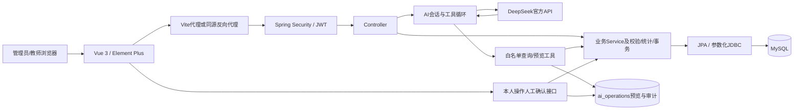

# 系统总体设计

第七阶段，2026-10-21，以实际代码为准。系统面向电脑浏览器，本地前后端分离部署，没有公网部署结论。

## 技术选型与职责

- Vue 3组合式API、Vue Router、Axios、Element Plus构成工作台；首页与管理页均访问真实API，生产产物由Vite构建。页签使用?view=保留导航。
- Spring Boot提供REST JSON接口，Controller接收DTO和当前主体，Service处理规则和事务；不是模型直接写数据库。
- 学生/班级使用Spring Data JPA，业务模块用Spring JDBC固定SQL；BusinessRepository进行字段名投影，不接受模型传来的SQL。
- Flyway V1–V4增量迁移，Hibernate ddl-auto=validate，sql.init.mode=never。无条件清表不在启动链中。
- DeepSeek使用Java HttpClient调用官方兼容/chat/completions，未引入独立Agent框架；模型输出Tool Calls，后端执行注册工具。

## 权限与认证

BCrypt保存密码；首次账号仅在不存在时按环境变量创建，不重置旧密码。JWT密钥外置且至少32字节，默认2小时；每请求查询当前账号及角色。未登录401，无权403。角色矩阵详见README；传统写操作ADMIN，AI教学确认ADMIN/TEACHER且只允许本人操作。没有任教班级关系，不能声称教师数据按班级隔离。

前端退出清除localStorage token/user并跳转登录；服务端logout未撤销JWT。旧令牌到期、签名密钥改变或账号删除后不再可用；降权影响后续请求。localStorage存在浏览器XSS暴露面，本轮未进行渗透测试，不把角色控制等同于完整安全认证。

## 业务数据流与口径

学生学号规范化及全局唯一，班级联合唯一和外键限制删除。名单导入先解析校验、服务端缓存预览，人工确认后同事务保存有效行，错误行跳过；文件与数据库冲突整批回滚。

成绩按学生/考试/科目唯一，分数使用DECIMAL；缺考NULL、真实零分0、未录入无行。排名按得分率精确交叉乘法比较，竞赛排名；平均分和及格率排除缺考。文件覆盖必须明确且校验旧快照，AI成绩永不覆盖。

作业创建和当前在读学生名单快照同事务；完成状态依据实际提交时间和截止时间计算。截止时间调整同步重算迟交，included=false排除统计，逾期未确认独立显示。考勤/表扬记录人由认证主体提供，修改保留创建者；考勤同学生/日/类型重复需确认。

仪表盘从真实表聚合学生、作业、考勤、表扬及最新考试；日期默认最近30天、最长366天。同科不同满分分别显示，不合并不同考试/科目总分。历史考勤/表扬按学生当前班级筛选，没有原班级快照。

## 事务、并发与失败

导入在TransactionTemplate内重新校验；成绩锁定考试/学生，唯一约束和外键兜底。作业名单与主记录共同提交。考勤锁定学生后重复检测。AI确认锁定本人ai_operations操作，重新构造快照并比较，业务记录与SUCCEEDED结果同事务；失败业务回滚后另记FAILED。操作ID作为幂等键，重复确认返回原状态，取消和过期不能写入。

预览缓存：传统文件预览在单实例内存，15分钟有效，重启需重传；AI操作持久化，15分钟有效；聊天会话在内存，30分钟闲置过期且按用户隔离。没有Redis或多实例共享聊天，不能宣称集群部署能力。

输入/认证/冲突错误返回安全JSON；一般异常只记录类型，数据库详情不直接返回。DeepSeek仅记录状态与用量，认证/额度/限流/超时转换中文失败，不返回上游正文、密钥或假成功。部分业务查询先全量再分页，适用于当前毕业设计规模，未做大数据性能验证。

## 本地部署与验证边界

