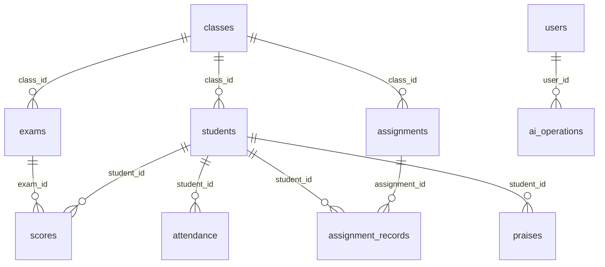

# 数据库设计

第七阶段，2026-10-21。设计来源为实际V1–V4 SQL迁移、实体和Service，不是设想的数据表。完整字段类型/可空性/默认值/约束见文末自动摘录的原始DDL。

MySQL 8.4.11验收库采用InnoDB及utf8mb4，业务表10张，加Flyway历史共11张。原3306/class_management本轮只读核验仍只有V1/V2，不代表原业务库已拥有全部表。



| 表 | 主键/主要字段 | 关键约束与语义 |
|---|---|---|
| users | 自增id；username/password/role | username唯一，密码BCrypt，角色ADMIN/TEACHER；不保存明文密码 |
| classes | 自增id；class_name/grade/academic_year，创建/更新时间 | 三字段联合唯一 |
| students | 自增id；student_no/name/gender/class_id/enrollment_date/status，创建/更新时间 | 学号唯一；班级外键；允许同名；状态在读/离校由Service校验 |
| exams | 自增id；name/class_id/exam_date，创建/更新时间 | 班级外键与日期索引，已有成绩不得更换班级 |
| scores | 自增id；student_id/exam_id/subject/score/full_score/status/remark，创建/更新时间 | 学生/考试外键，三字段唯一；DECIMAL分数CHECK；缺考NULL、实考零分0 |
| assignments | 自增id；name/class_id/subject/description/assigned_date/deadline，创建/更新时间 | 班级外键、日期索引；Service校验截止日期 |
| assignment_records | 自增id；assignment_id/student_id/status/submitted_at/remark/included，创建/更新时间 | 作业/学生外键；组合唯一；状态CHECK；included控制统计 |
| attendance | 自增id；student_id/type/occurred_date/occurred_time/remark/recorder，创建/更新时间 | 学生外键、日期索引、类型CHECK；同日多次由显式重复确认处理 |
| praises | 自增id；student_id/praise_date/reason/remark/recorder，创建/更新时间 | 学生外键、日期索引；允许多条表扬 |
| ai_operations | UUID id；user_id/owner/kind/status/payload/preview/result/failure，创建/更新/过期时间 | 账号外键；操作ID幂等；保存预览/前后快照和真实结果，非任意SQL日志 |
| flyway_schema_history | installed_rank等框架字段 | Flyway维护版本、校验和与迁移结果，不手工改写 |

所有外键限制删除，不级联删除业务历史。考勤/表扬recorder为创建账号名快照，无账号外键；服务端填充，客户端不可伪造，修改保留原值。AI审计通过user_id关联账号，存在审计时外键也会限制账号物理删除。

数据库CHECK和Service校验共同保证成绩范围、缺考分数关系、作业/考勤枚举；学生与考试同班、提交时间合理性、文本长度、教师权限等由Service处理，不能声称全部由数据库CHECK覆盖。

作业名单固定在布置时，included=false排除；逾期PENDING在查询投影为UNCONFIRMED，数据库不自动修改状态。成绩均值、排名及及格率排除ABSENT与无记录。考勤/表扬按学生当前班级筛选，历史没有原班级快照；考试/作业保留所属班级。

## 迁移和事务

空库执行V1用户、V2班级学生、V3六张教学表、V4 AI操作表。已有无Flyway历史非空旧库baseline=1，再增量迁移；须先备份和结构核对。Hibernate validate、SQL初始化never，不运行无条件删表脚本。旧迁移未修改，迁移测试核对旧账号/学生ID/关联保留和重复执行不重复迁移。

成绩/作业/考勤/表扬写入为事务。成绩锁定考试和学生，AI确认锁定本人操作、复核目标快照；业务变更和SUCCEEDED结果共同提交，失败业务回滚后记录FAILED。传统文件预览在内存、AI预览持久化，二者重启语义不同。


## 实际迁移DDL

以下由当前backend/src/main/resources/db/migration文件摘录，字段类型和默认值以这些文件为依据；Flyway自己的表结构由框架版本决定。

### V1__users.sql

```sql
CREATE TABLE IF NOT EXISTS users (id BIGINT AUTO_INCREMENT PRIMARY KEY, username VARCHAR(100) NOT NULL UNIQUE, password VARCHAR(255) NOT NULL, role VARCHAR(30) NOT NULL);

```

### V2__student_class.sql

```sql
CREATE TABLE IF NOT EXISTS users (id BIGINT AUTO_INCREMENT PRIMARY KEY, username VARCHAR(100) NOT NULL UNIQUE, password VARCHAR(255) NOT NULL, role VARCHAR(30) NOT NULL);
CREATE TABLE IF NOT EXISTS classes (id BIGINT AUTO_INCREMENT PRIMARY KEY, class_name VARCHAR(100) NOT NULL, grade VARCHAR(50) NOT NULL, academic_year VARCHAR(20) NOT NULL, created_at DATETIME NOT NULL, updated_at DATETIME NOT NULL, CONSTRAINT uq_class_business UNIQUE (class_name, grade, academic_year));
CREATE TABLE IF NOT EXISTS students (id BIGINT AUTO_INCREMENT PRIMARY KEY, student_no VARCHAR(50) NOT NULL UNIQUE, name VARCHAR(100) NOT NULL, gender VARCHAR(20), class_id BIGINT NOT NULL, enrollment_date DATE, status VARCHAR(30) NOT NULL DEFAULT '在读', created_at DATETIME NOT NULL, updated_at DATETIME NOT NULL, CONSTRAINT fk_student_class FOREIGN KEY (class_id) REFERENCES classes(id));

```

### V3__teaching_business.sql

```sql
CREATE TABLE exams (
 id BIGINT AUTO_INCREMENT PRIMARY KEY, name VARCHAR(100) NOT NULL,
 class_id BIGINT NOT NULL, exam_date DATE NOT NULL, created_at TIMESTAMP NOT NULL DEFAULT CURRENT_TIMESTAMP,
 updated_at TIMESTAMP NOT NULL DEFAULT CURRENT_TIMESTAMP,
 CONSTRAINT fk_exam_class FOREIGN KEY(class_id) REFERENCES classes(id)
);
CREATE TABLE scores (
 id BIGINT AUTO_INCREMENT PRIMARY KEY, student_id BIGINT NOT NULL, exam_id BIGINT NOT NULL,
 subject VARCHAR(50) NOT NULL, score DECIMAL(10,2), full_score DECIMAL(10,2) NOT NULL,
 status VARCHAR(20) NOT NULL, remark VARCHAR(500) NOT NULL DEFAULT '',
 created_at TIMESTAMP NOT NULL DEFAULT CURRENT_TIMESTAMP, updated_at TIMESTAMP NOT NULL DEFAULT CURRENT_TIMESTAMP,
 CONSTRAINT uk_score UNIQUE(student_id,exam_id,subject),
 CONSTRAINT fk_score_student FOREIGN KEY(student_id) REFERENCES students(id),
 CONSTRAINT fk_score_exam FOREIGN KEY(exam_id) REFERENCES exams(id),
 CONSTRAINT ck_score CHECK(full_score>0 AND ((status='RECORDED' AND score IS NOT NULL AND score>=0 AND score<=full_score) OR (status='ABSENT' AND score IS NULL)))
);
CREATE TABLE assignments (
 id BIGINT AUTO_INCREMENT PRIMARY KEY, name VARCHAR(100) NOT NULL, class_id BIGINT NOT NULL,
 subject VARCHAR(50) NOT NULL, description VARCHAR(2000) NOT NULL DEFAULT '', assigned_date DATE NOT NULL,
 deadline DATETIME NOT NULL, created_at TIMESTAMP NOT NULL DEFAULT CURRENT_TIMESTAMP,
 updated_at TIMESTAMP NOT NULL DEFAULT CURRENT_TIMESTAMP,
 CONSTRAINT fk_assignment_class FOREIGN KEY(class_id) REFERENCES classes(id)
);
CREATE TABLE assignment_records (
 id BIGINT AUTO_INCREMENT PRIMARY KEY, assignment_id BIGINT NOT NULL, student_id BIGINT NOT NULL,
 status VARCHAR(20) NOT NULL DEFAULT 'PENDING', submitted_at DATETIME,
 remark VARCHAR(500) NOT NULL DEFAULT '', included BOOLEAN NOT NULL DEFAULT TRUE,
 created_at TIMESTAMP NOT NULL DEFAULT CURRENT_TIMESTAMP, updated_at TIMESTAMP NOT NULL DEFAULT CURRENT_TIMESTAMP,
 CONSTRAINT uk_assignment_student UNIQUE(assignment_id,student_id),
 CONSTRAINT fk_record_assignment FOREIGN KEY(assignment_id) REFERENCES assignments(id),
 CONSTRAINT fk_record_student FOREIGN KEY(student_id) REFERENCES students(id),
 CONSTRAINT ck_assignment_status CHECK(status IN ('PENDING','COMPLETED','INCOMPLETE','LATE'))
);
CREATE TABLE attendance (
 id BIGINT AUTO_INCREMENT PRIMARY KEY, student_id BIGINT NOT NULL, type VARCHAR(20) NOT NULL,
 occurred_date DATE NOT NULL, occurred_time TIME, remark VARCHAR(500) NOT NULL DEFAULT '',
 recorder VARCHAR(100) NOT NULL, created_at TIMESTAMP NOT NULL DEFAULT CURRENT_TIMESTAMP,
 updated_at TIMESTAMP NOT NULL DEFAULT CURRENT_TIMESTAMP,
 CONSTRAINT fk_attendance_student FOREIGN KEY(student_id) REFERENCES students(id),
 CONSTRAINT ck_attendance_type CHECK(type IN ('LATE','EARLY_LEAVE','ABSENT'))
);
CREATE TABLE praises (
 id BIGINT AUTO_INCREMENT PRIMARY KEY, student_id BIGINT NOT NULL, praise_date DATE NOT NULL,
 reason VARCHAR(500) NOT NULL, remark VARCHAR(500) NOT NULL DEFAULT '', recorder VARCHAR(100) NOT NULL,
 created_at TIMESTAMP NOT NULL DEFAULT CURRENT_TIMESTAMP, updated_at TIMESTAMP NOT NULL DEFAULT CURRENT_TIMESTAMP,
 CONSTRAINT fk_praise_student FOREIGN KEY(student_id) REFERENCES students(id)
);
CREATE INDEX ix_exam_class_date ON exams(class_id,exam_date);
CREATE INDEX ix_assignment_class_date ON assignments(class_id,assigned_date);
CREATE INDEX ix_attendance_date_student ON attendance(occurred_date,student_id);
CREATE INDEX ix_praise_date_student ON praises(praise_date,student_id);

```

### V4__ai_operations.sql

```sql
CREATE TABLE ai_operations (
 id VARCHAR(36) PRIMARY KEY,
 user_id BIGINT NOT NULL,
 owner VARCHAR(100) NOT NULL,
 kind VARCHAR(40) NOT NULL,
 status VARCHAR(20) NOT NULL,
 payload TEXT NOT NULL,
 preview TEXT NOT NULL,
 result TEXT,
 failure VARCHAR(500),
 created_at TIMESTAMP NOT NULL DEFAULT CURRENT_TIMESTAMP,
 updated_at TIMESTAMP NOT NULL DEFAULT CURRENT_TIMESTAMP,
 expires_at TIMESTAMP NOT NULL,
 FOREIGN KEY (user_id) REFERENCES users(id)
);

```
